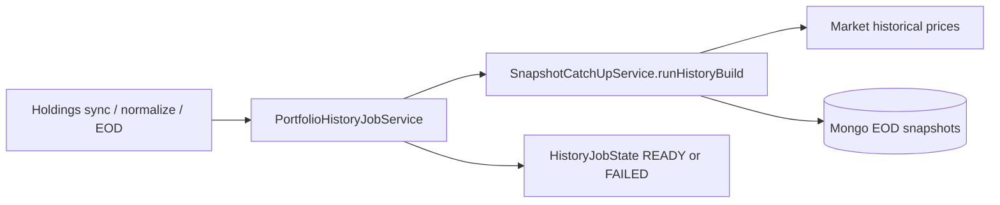
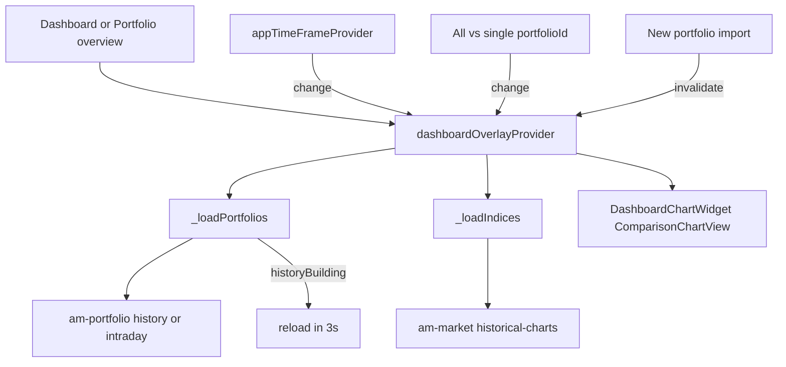

# FLOW — portfolio chart build + read

## Mental model

There is **no** HTTP verb `buildPortfolioChart`.  
**Build** = async Mongo EOD snapshot catch-up (`SnapshotCatchUpService` / `PortfolioHistoryJobService`).  
**Read** = overlay UI loads wealth from am-portfolio and indices from am-market, then rebases to %.

## Write path (build history)

| Step | Detail |
|------|--------|
| Triggers | Post sync/normalize; EOD scheduler; `POST /v1/portfolios/dev/trigger-catchup`; `POST /v1/portfolios/trigger-snapshot` |
| Modes | `FULL`, `GAP`, `MERGE_BROKER` (`HistoryJobMode`) |
| Phases | `QUEUED` → `BUILDING_90D` → `BUILDING_1Y` → `READY` (or `FAILED`) |
| Abort | No holdings → nothing to build / EMPTY |

## Read path (live comparison chart)

1. Mount chart (see [UI-MAPPING.md](./UI-MAPPING.md)).
2. `reload()` loads portfolio series, then index series for selected symbols.
3. Series need ≥ 2 finite positive points after `%` rebase to draw.
4. While `historyStatus == BUILDING`, Portfolio shows syncing banner and overlay reloads every 3s.

### Multi-portfolio URL shape (dig)

| Selection | Example |
|-----------|---------|
| **All** portfolios | `GET /v1/portfolios/history?timeFrame=1Y` — **no** `{portfolioId}` in path |
| **One** portfolio | `GET /v1/portfolios/{portfolioId}/history?timeFrame=1Y` |
| **All** + 1D | `GET /v1/portfolios/intraday` |
| **One** + 1D | `GET /v1/portfolios/{portfolioId}/intraday` |

Seeing `.../history?timeFrame=1Y` without an id means the UI is on **All** — that is correct for aggregate wealth. Backend filters nested snapshot entries when path id is set; omits filter for All.

**After adding a new portfolio (import):** call history/intraday **again** with the current selection (All URL or new `{id}` URL). Do not keep the previous response in memory as SoT; BUILDING poll should use the same URL shape so only the selected chart series reloads.

## Beside the chart (not the line series)

| Path | Service | Role |
|------|---------|------|
| `GET /v1/analysis/dashboard/summary` | am-analysis | Dashboard KPI cards |
| `GET /v1/analysis/dashboard/performance` | am-analysis | Legacy `chartData` — **not** wired to overlay widget |

## Related UX pack

Timeframe window / 1D session polish: `am-modern-ui/docs/overview-chart-timeframe-sync/`.
